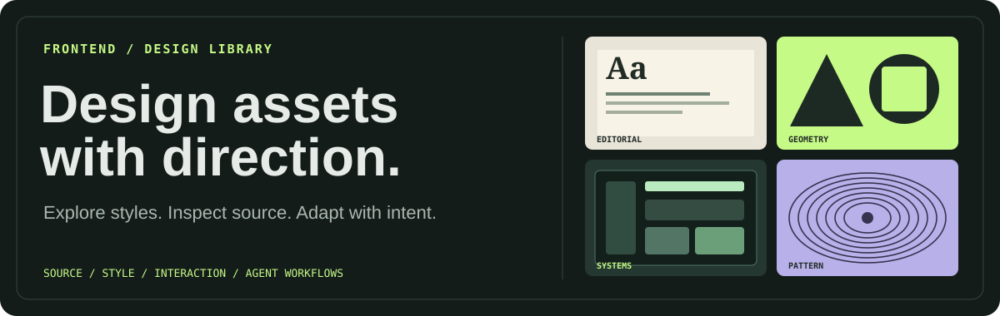
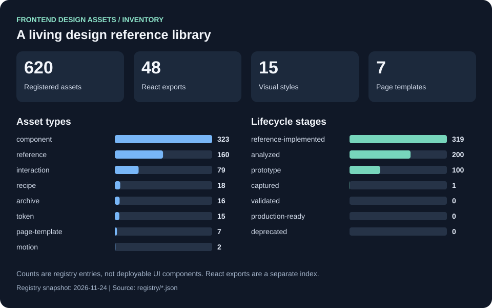
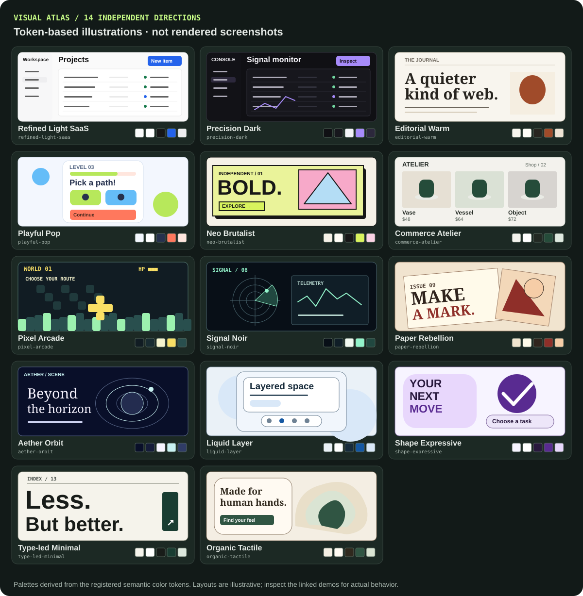
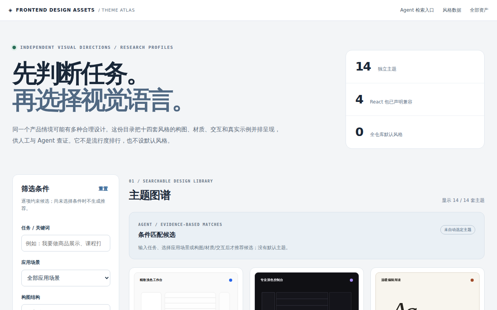
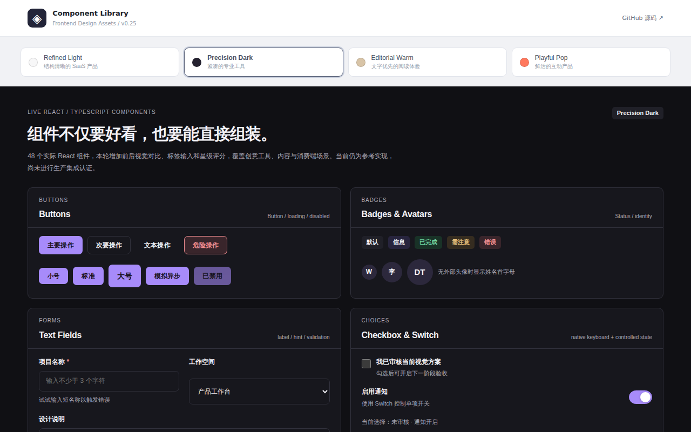
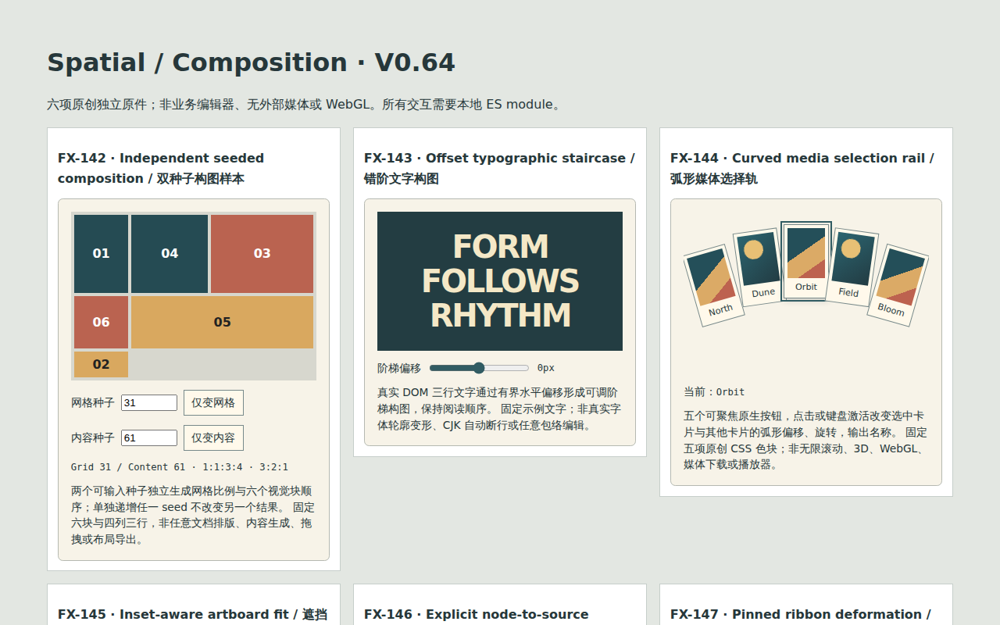
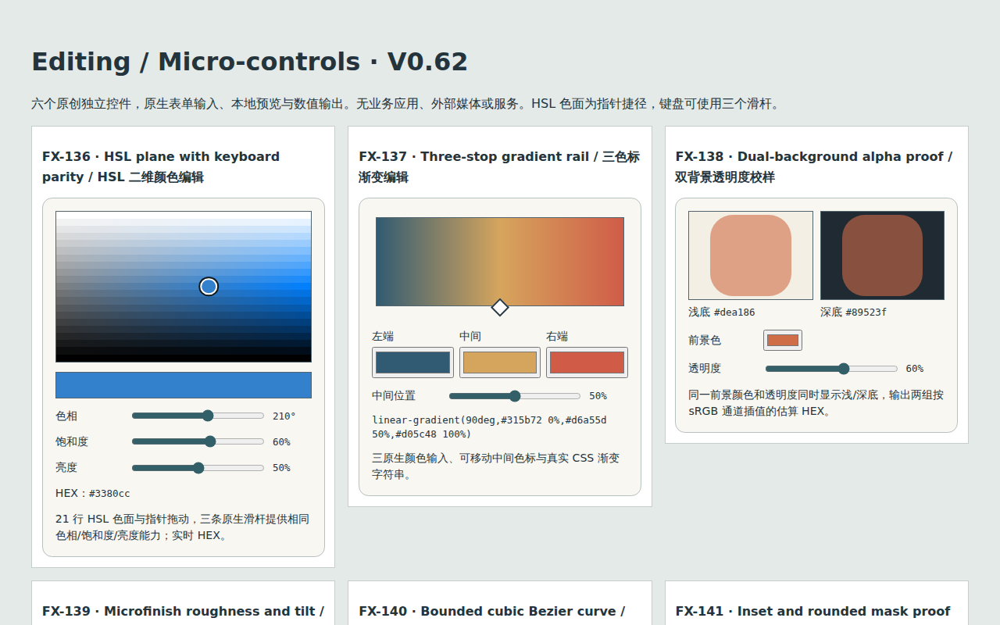
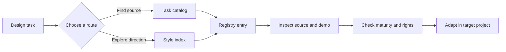

# Frontend Design Assets



**A curated, evolving library of frontend design materials for developers, designers and AI agents.**

Explore distinct visual styles, locate reusable React and native web source, inspect original SVG artwork, and turn interaction research into informed implementation decisions.

[中文指南](README.zh-CN.md) · [Live preview (GitHub Pages)](https://mingqiangdu1-arch.github.io/frontend-design-assets/) · [Explore the gallery](docs/gallery.md) · [Agent quick start](DISCOVER.md) · [Task catalog](CATALOG.md) · [Contributing](CONTRIBUTING.md)



*Snapshot: 2026-11-24. Counts come from the canonical registries; registered assets include research, prototypes and source references, not just implemented components. See [inventory data and regeneration](docs/README.md#inventory).*

## Explore 15 visual directions

[](docs/gallery.md#visual-directions--视觉风格)

*Static compositions derived from actual semantic color tokens, not screenshots. [Explore themes and source demos](docs/gallery.md) · [Local preview and screenshot guide](docs/visual-showcase.md).* The React package supports four explicitly registered themes, not all fifteen.

## Live UI screenshots

| Theme Atlas (15 Styles) | React Component Gallery (Dark) |
| :---: | :---: |
|  |  |
| **Spatial Composition (V0.64)** | **Creative Micro-Controls (V0.62)** |
|  |  |

*Captured at 1280 × 800 in Chromium from actual repository demos. [All screenshots and live preview guide →](docs/visual-showcase.md)*

## Explore real materials

| Procedural graphics | Editorial patterns | Experimental form |
| :---: | :---: | :---: |
| [](graphics/v061/orbit-filigree.svg) | [](graphics/v061/overprint-ridge.svg) | [](graphics/v061/stipple-eclipse.svg) |
| VG-111 · vector pattern | VG-113 · layered composition | VG-114 · ordered texture |

Actual original SVG files from the repository, not product screenshots. [More visual specimens and interactive labs →](docs/gallery.md)

## Find what you need

| Goal | Start here |
| --- | --- |
| Choose a visual direction | [Style atlas](playground/style-atlas/README.md) · [Style index](registry/styles.json) · [Selection matrix](docs/styles/decision-matrix.md) |
| Find React component source | [Component index](registry/components.json) · [Implementation guide](packages/ui/README.md) |
| Find native CSS, JavaScript or SVG materials | [Task catalog](CATALOG.md) · [Primitives](styles/primitives/) · [Graphics](graphics/) |
| Explore behavior and composition | [Interaction patterns](docs/interactions/) · [Page templates](registry/page-templates.json) · [Recipes](recipes/) |
| Research upstream projects | [Research archive](docs/research/) · [Source and reuse guidance](registry/README.md) |
| Work with an AI agent | [Discovery routes](DISCOVER.md) · [Agent guide](AGENTS.md) · [13 local skills + 2 external references](.agents/skills/README.md) |

## How the library works



Stable asset IDs connect task-oriented discovery to canonical metadata, actual source, demos, dependencies and reuse limitations. The library does not build or deploy your application.

## Quick start

No installation is required to browse the catalog, registry, skills or SVG files. For local term-based search (Node.js 22+):

```sh
node scripts/find-assets.mjs --intent="editable table" --family=UI --goal=implementation --compact --json
node scripts/find-assets.mjs --intent="pixel" --family=VG --limit=5 --compact --json
node scripts/select-style.mjs --task="a liquid glass navigation" --format=markdown
```

For a local interactive gallery and validation:

```sh
npm install
npm run dev:components
npm run test:registry
npm run test:unit
npm run check:components
```

See the [gallery guide](docs/gallery.md) for native demos, [visual showcase](docs/visual-showcase.md) for screenshots and live preview, and [quality documentation](docs/quality/README.md) for the scope of validation.

## Repository map

| Directory | Responsibility |
| --- | --- |
| [registry/](registry/) | Canonical machine-readable asset, style and component indexes |
| [packages/ui/](packages/ui/) | React/TSX reference implementations |
| [styles/](styles/) · [tokens/](tokens/) | Independent styles, design tokens and native source atoms |
| [graphics/](graphics/) | Original vector graphics and illustrations |
| [recipes/](recipes/) · [playground/](playground/) | Composition guidance and independent runnable experiments |
| [docs/](docs/README.md) | Guides, research, visual gallery and quality evidence |
| [.agents/skills/](.agents/skills/README.md) | Local workflows, pinned bundled skills and external references |
| [scripts/](scripts/) · [tests/](tests/) | Discovery, inventory generation and scoped validation |
| [archive/](archive/) | Historical reference material |

## Maturity, attribution and scope

- **Reference implementations** are inspectable starting points; prototypes and external research are not installed components. Only the component index lists React exports.
- There is no universal default visual theme, published npm package, production certification, website builder or application scaffold.
- Check each asset's source, license, dependencies and applicability before reuse. External references and vendored skills retain their own terms; see [third-party skill notices](.agents/skills/THIRD_PARTY_NOTICES.md).
- Original material owned by the repository owner is available under the [MIT License](LICENSE). Third-party content and references retain their own terms; see [scope and attribution](NOTICE.md), [licensing review](docs/licensing.md) and [publication readiness](docs/publication-readiness.md).

[Changelog](CHANGELOG.md) · [Governance](docs/governance.md) · [Release maintenance](docs/release-maintenance.md) · [Community conduct](CODE_OF_CONDUCT.md) · [Security](SECURITY.md)
