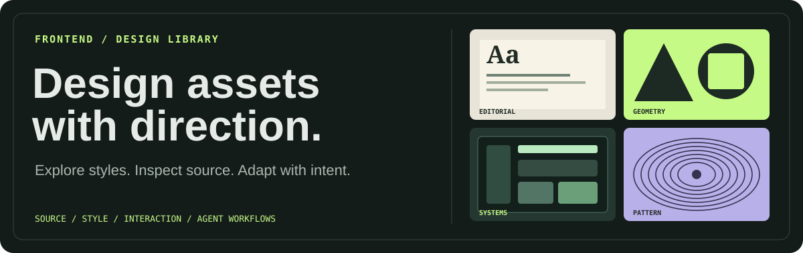
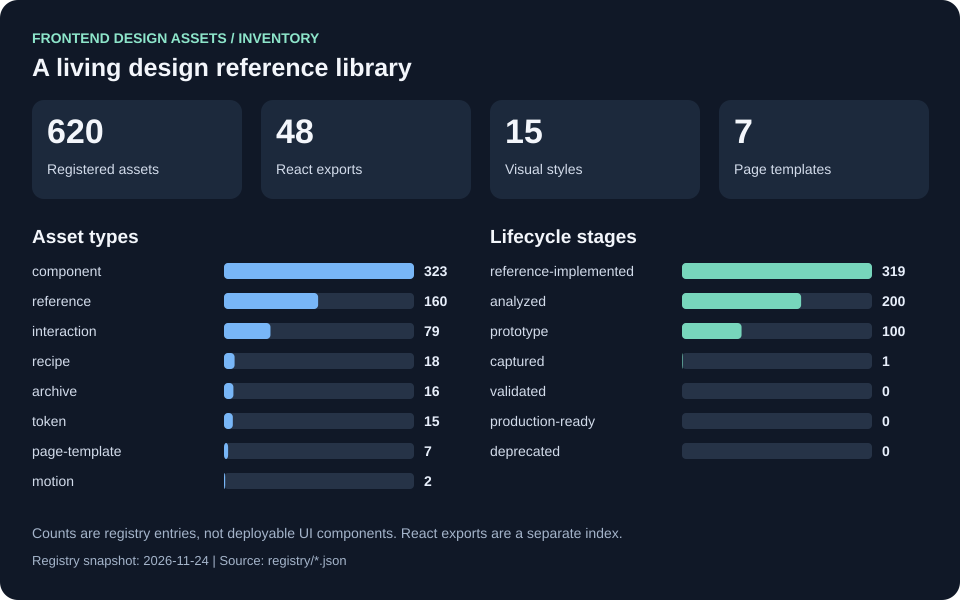
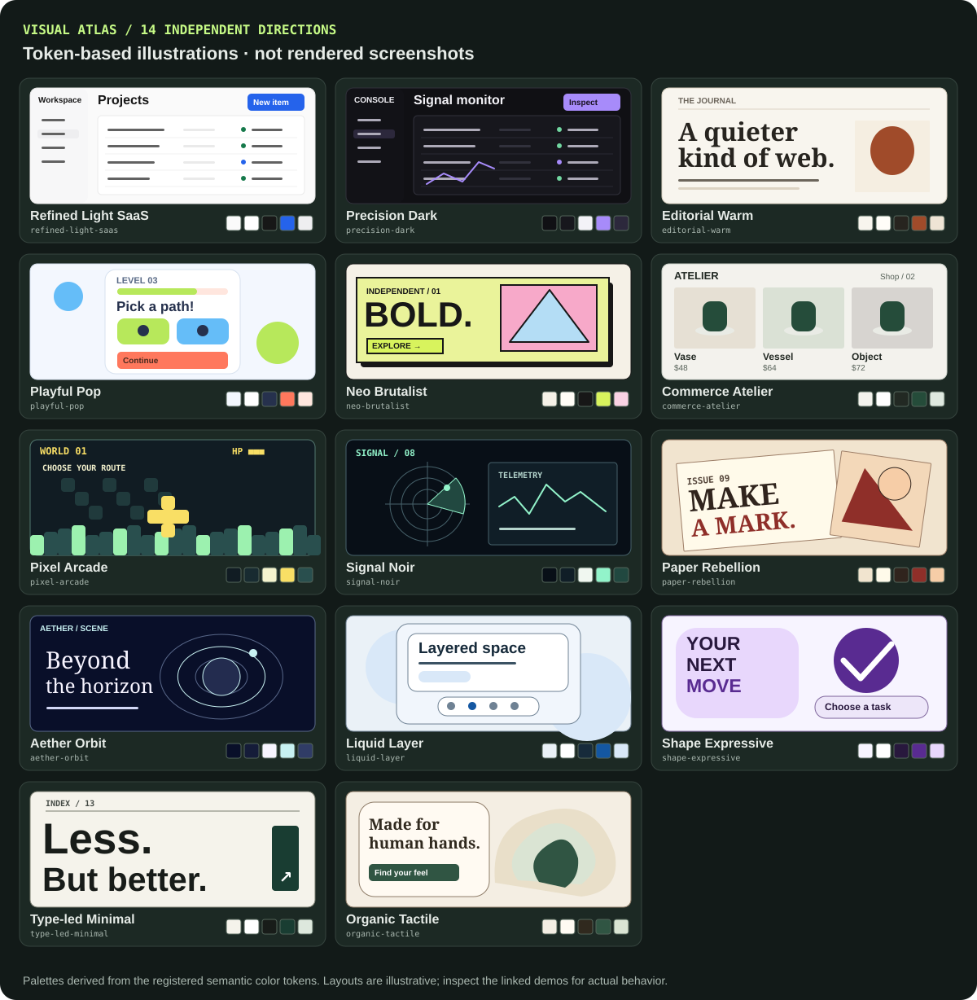
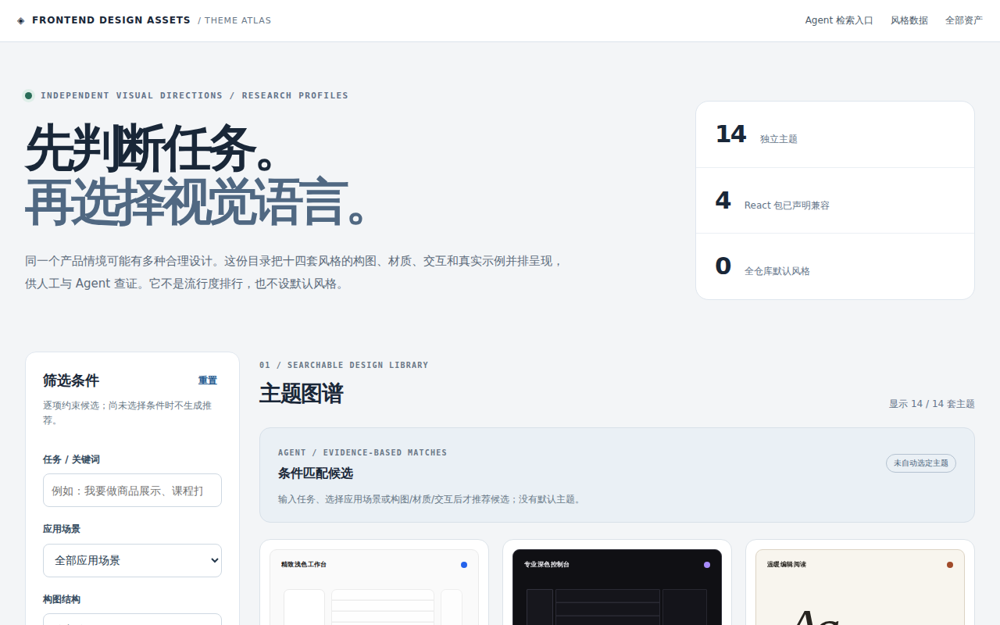
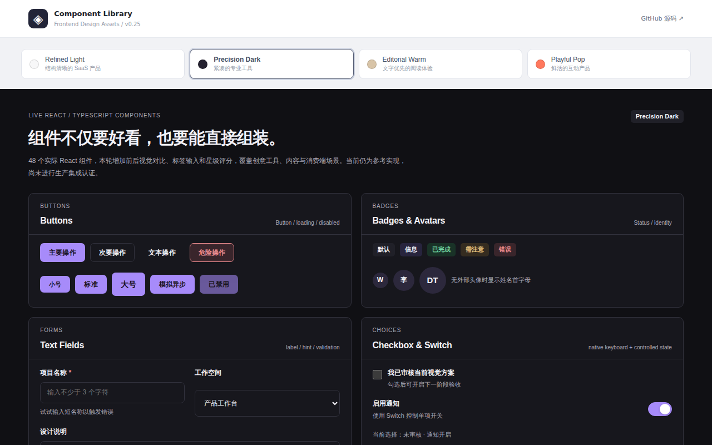
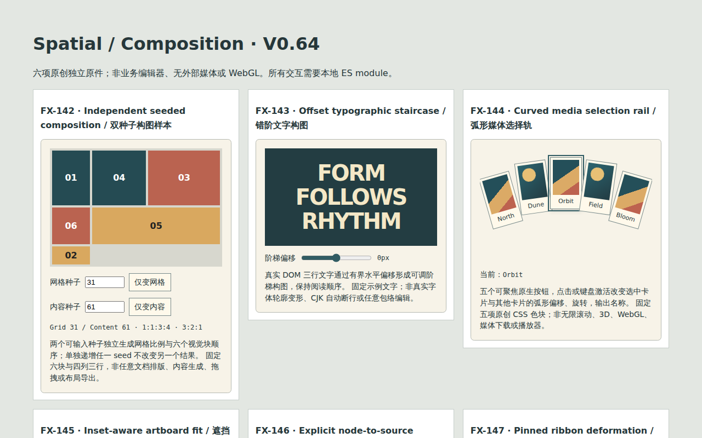
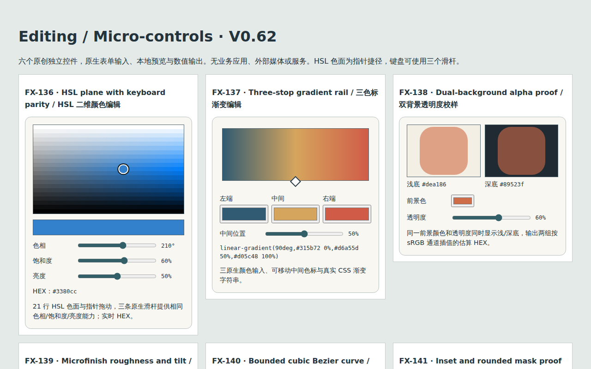
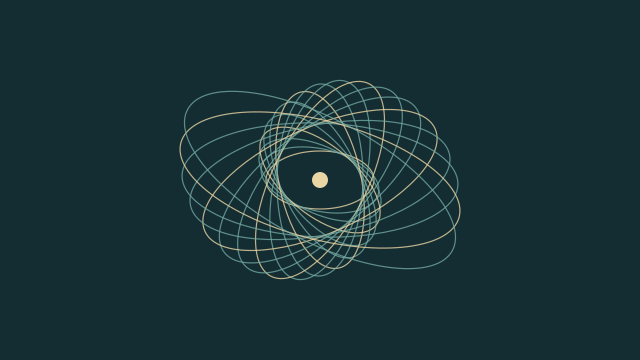

# Frontend Design Assets · 中文指南



[English README](README.md) · [在线交互预览 (GitHub Pages)](https://mingqiangdu1-arch.github.io/frontend-design-assets/) · [素材预览](docs/gallery.md) · [贡献指南](CONTRIBUTING.md)

面向开发者、设计师与 AI Agent 的持续更新型前端设计素材库。按任务查找真实原件，或从多个独立视觉方向中选择合适的设计依据。收录 React 参考组件、原生 CSS/JS、SVG 图形、设计 Token、交互原型、页面配方与上游研究。



## 15 套视觉风格

[](docs/gallery.md)

这是静态风格示意，而非实际运行截图。查看[分类素材画廊](docs/gallery.md)及[真实 Demo、截图与在线预览指南](docs/visual-showcase.md)。React 组件包仅声明四套兼容主题。

## 真实界面截图

| Theme Atlas（15 套风格对照） | React 组件画廊（Precision Dark） |
| :---: | :---: |
|  |  |
| **空间构图原件（V0.64）** | **创意编辑微控件（V0.62）** |
|  |  |

*以上均为 Chromium 1280 × 800 实际渲染截图。查看[完整截图与在线预览指南](docs/visual-showcase.md)。*

## 精选原创图形素材

| 程序化丝纹（`VG-111` · 轨道丝纹） | 几何拼砖纹样（`VG-112` · 拼砖罗盘） |
| :---: | :---: |
| [](graphics/v061/orbit-filigree.svg) | [](graphics/v061/quilt-compass.svg) |
| **叠印山脊（`VG-113` · 套色山脊）** | **点阵蚀圆（`VG-114` · 点纹蚀圆）** |
| [](graphics/v061/overprint-ridge.svg) | [](graphics/v061/stipple-eclipse.svg) |

*以上均为仓库内真实原创 640 × 360 SVG 原件，非产品截图。查看[更多视觉样张与交互实验 →](docs/gallery.md)*

## 如何使用

| 需求 | 入口 |
| --- | --- |
| 找到可以参考或改造的实物 | [任务索引](CATALOG.md) → 对应登记项 → 源码与 Demo |
| 尚未确定视觉方向 | [风格索引](registry/styles.json) · [主题图谱](playground/style-atlas/README.md) · [选型矩阵](docs/styles/decision-matrix.md) |
| 让 AI Agent 自动检索和选型 | [两条检索路线](DISCOVER.md) · [Agent 工作指南](AGENTS.md) · [14 项本地技能 + 2 项外部参考](.agents/skills/README.md) |
| 直接查看 React 导出 | [组件索引](registry/components.json) · [源码说明](packages/ui/README.md) |
| 欣赏原创图形与交互实验 | [素材画廊](docs/gallery.md) |
| 研究外部项目及许可 | [研究目录](docs/research/) · [素材登记规则](registry/README.md) |

## 本地使用（Node.js 22+）

```sh
node scripts/find-assets.mjs --intent="图片对比滑块" --family=UI --goal=implementation --compact --json
node scripts/find-assets.mjs --intent="像素" --family=VG --limit=5 --compact --json
node scripts/select-style.mjs --task="液态玻璃导航" --format=markdown
npm install
npm run dev:components
```

GitHub-only 用户直接通过索引访问源码即可；HTML/ES module Demo 请按[画廊说明](docs/gallery.md)本地启动或直接访问在线预览页。

## 复用边界

本库不是业务应用、页面生成器、统一 UI 框架或已发布 npm 包。不同风格独立维护。登记项包含研究、原型与参考实现；请先检查其生命周期、来源、许可、依赖、适用场景和验证记录。真实产品的组装与部署在目标项目中完成。

权利人拥有授权权利的原创代码、文档、设计素材与 SVG 等采用 [MIT 许可证](LICENSE)。第三方内容继续遵循原始授权，详见[授权范围与归属](NOTICE.md)；详见[授权与来源审查](docs/licensing.md)与[发布门禁](docs/publication-readiness.md)。

[文档导航](docs/README.md) · [更新日志](CHANGELOG.md) · [维护规则](docs/governance.md) · [发布与维护](docs/release-maintenance.md) · [社区行为规范](CODE_OF_CONDUCT.md) · [安全报告](SECURITY.md)
