# Visual gallery / 素材画廊

[Home](../README.md) · [Task catalog](../CATALOG.md) · [Style atlas](../playground/style-atlas/README.md) · [Visual evidence](visual-showcase.md)

Browse by visual direction, original graphics, or working interaction. The visual atlas is a token-based illustration; the graphic thumbnails are actual source SVGs; links to HTML/TSX refer to existing demos or implementation, not screenshots.

## Visual directions / 视觉风格

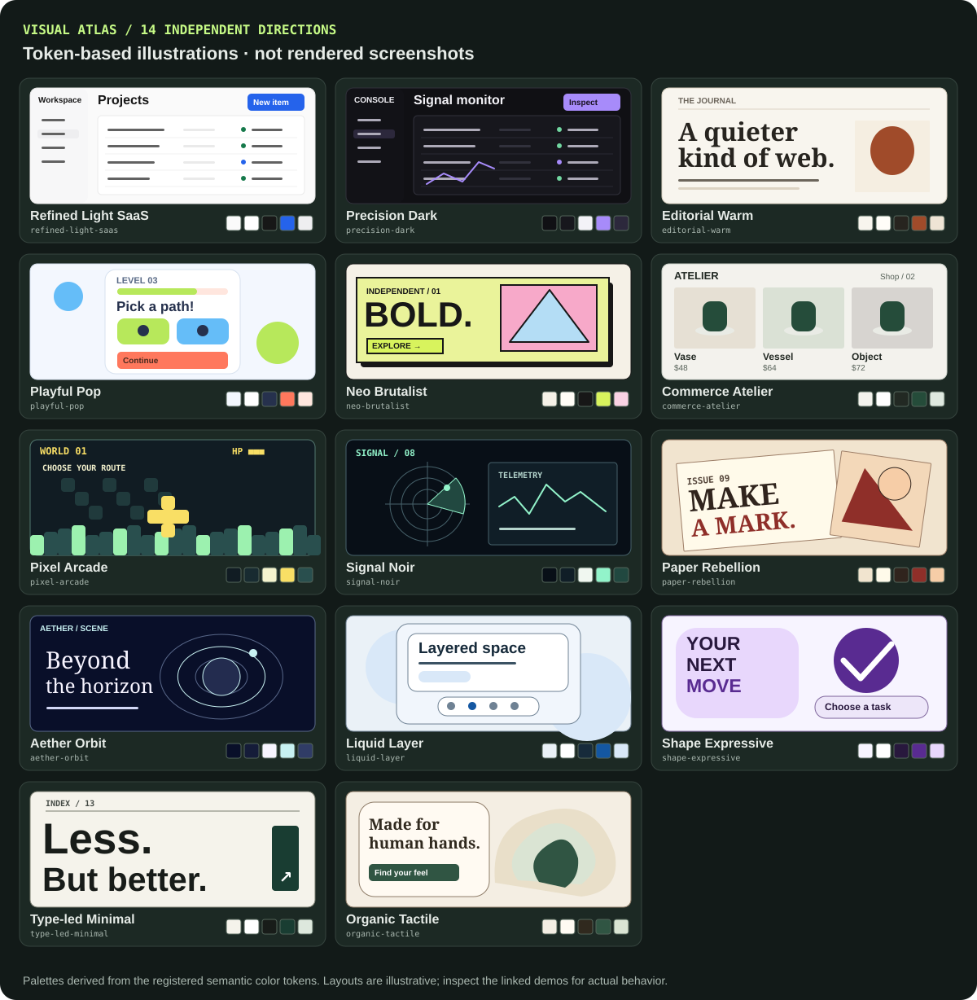

The compositions are original static interpretations of the registered visual grammar, not runtime screenshots. No theme is the default. For interactive comparison, see [Theme Atlas](../playground/style-atlas/README.md).

| Style | Direction / 设计方向 | Source |
| --- | --- | --- |
| **Refined Light SaaS** / 精致浅色工作台 | 低饱和浅色、微弱边界与信息层级；面向可持续的业务操作 | [Tokens](../tokens/refined-light.json) · [Source demo](../playground/initial-interaction-lab.html) |
| **Precision Dark** / 专业深色控制台 | 深炭色精密工作环境，紧凑行距与高效键盘控制 | [Tokens](../styles/precision-dark/tokens.json) · [Source demo](../playground/style-explorer/index.html) |
| **Editorial Warm** / 温暖编辑阅读 | 奶油色纸张和衬线字形，服务长文阅读和编辑 | [Tokens](../styles/editorial-warm/tokens.json) · [Source demo](../playground/style-explorer/index.html) |
| **Playful Pop** / 趣味学习与激励 | 高饱和友好色块、进度奖励与明确任务反馈 | [Tokens](../styles/playful-pop/tokens.json) · [Source demo](../playground/style-explorer/index.html) |
| **Neo Brutalist** / 高对比粗野主义 | 大胆黑框、错位阴影和海报式栅格，面向活动与独立品牌 | [Tokens](../styles/neo-brutalist/tokens.json) · [Source demo](../playground/bold-grid/index.html) |
| **Commerce Atelier** / 商品优先零售 | 大商品展示、清晰的价格与规格，按消费决策而非后台记录组织内容 | [Tokens](../styles/commerce-atelier/tokens.json) · [Source demo](../playground/commerce-atelier/index.html) |
| **Pixel Arcade** / 像素游戏世界 | 像素地貌和离散 HUD，采用游戏章节而不是传统页面跳转 | [Tokens](../styles/pixel-arcade/tokens.json) · [Source demo](../playground/creative-style-lab/index.html) |
| **Signal Noir** / 未来仪器信号 | 科幻遥测仪表、角度分割与精密数据叙事 | [Tokens](../styles/signal-noir/tokens.json) · [Source demo](../playground/creative-style-lab/index.html) |
| **Paper Rebellion** / 拼贴杂志与手作 | 不对称纸张拼贴、手绘感注释和杂志叙事 | [Tokens](../styles/paper-rebellion/tokens.json) · [Source demo](../playground/creative-style-lab/index.html) |
| **Aether Orbit** / 氛围空间与轨道 | 暗色空间、缓慢轨道、放松型场景导航 | [Tokens](../styles/aether-orbit/tokens.json) · [Source demo](../playground/creative-style-lab/index.html) |
| **Liquid Layer** / 透明悬浮功能层 | 场景画面保留完整表达，透明材质只用于浮动交互层 | [Tokens](../styles/liquid-layer/tokens.json) · [Source demo](../playground/trend-style-lab/index.html) |
| **Shape Expressive** / 表现力形状任务 | 以形状区分任务与动作层级的表现力移动界面 | [Tokens](../styles/shape-expressive/tokens.json) · [Source demo](../playground/trend-style-lab/index.html) |
| **Type-led Minimal** / 字体主导极简 | 大尺度排版、精简信息与可发现的深入阅读路径 | [Tokens](../styles/type-led-minimal/tokens.json) · [Source demo](../playground/trend-style-lab/index.html) |
| **Organic Tactile** / 有机触感自然材质 | 自然材料和人文温度的可阅读商品/服务叙事 | [Tokens](../styles/organic-tactile/tokens.json) · [Source demo](../playground/trend-style-lab/index.html) |

## Original vectors / 原创图形

The following sixteen thumbnails link to their actual standalone SVGs; the images are original illustrative works, not real-world measurement or product photographs.

### Data-inspired graphic studies / 数据意象

| | |
| --- | --- |
| [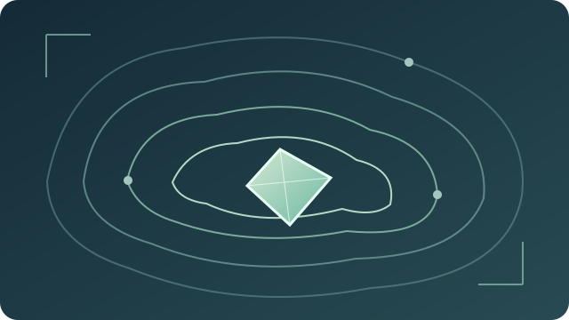](../graphics/v057/decision-contours.svg) **VG-099 · Decision contours / 决策轮廓艺术** | [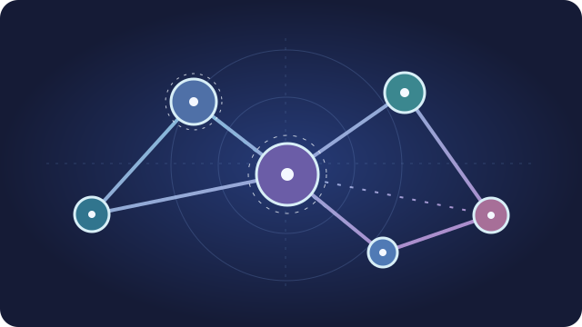](../graphics/v057/metric-constellation.svg) **VG-100 · Metric constellation / 指标星群插画** |
| [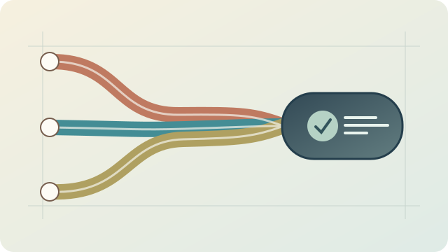](../graphics/v057/provenance-loom.svg) **VG-101 · Provenance loom / 来源织带图** | [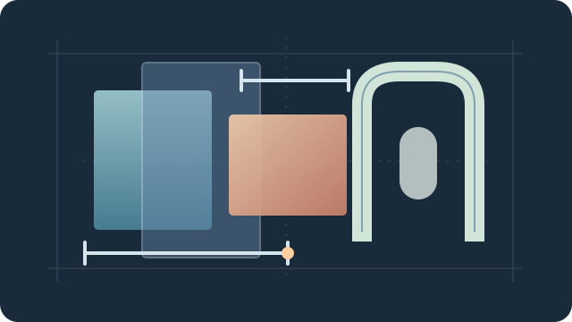](../graphics/v057/interval-architecture.svg) **VG-102 · Interval architecture / 区间构筑图** |

### Object and material studies / 物件与材质

| | |
| --- | --- |
| [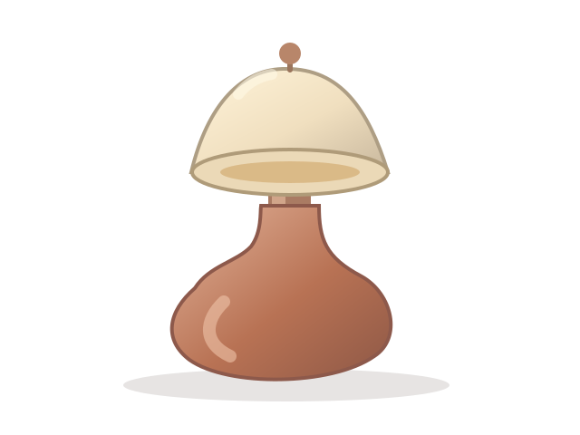](../graphics/v058/ceramic-desk-lamp.svg) **VG-103 · Ceramic desk lamp / 陶瓷桌灯概念矢量** | [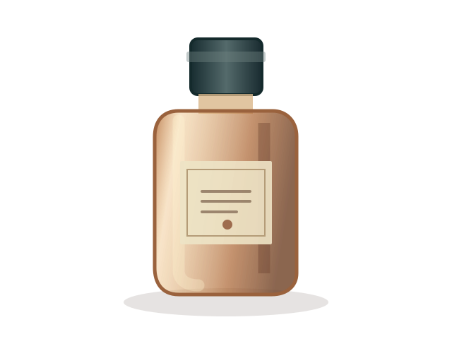](../graphics/v058/tinted-vial.svg) **VG-104 · Tinted vial / 琥珀玻璃容器概念矢量** |
| [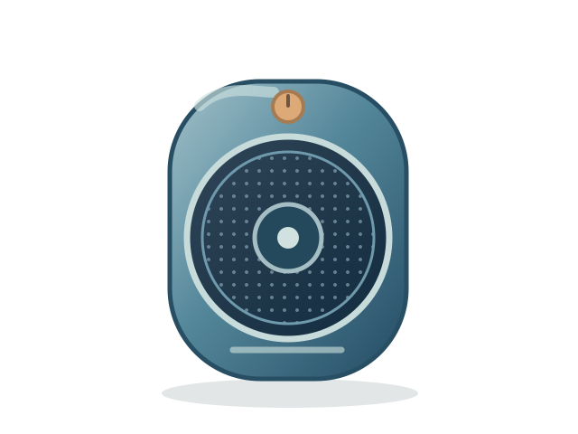](../graphics/v058/sound-pod.svg) **VG-105 · Sound pod / 便携声音设备概念矢量** |  **VG-106 · Folded notebook / 折页随记本概念矢量** |

### Pixel and glyph illustrations / 像素与字符

| | |
| --- | --- |
|  **VG-107 · Raster sunrise / 点阵日出插画** | [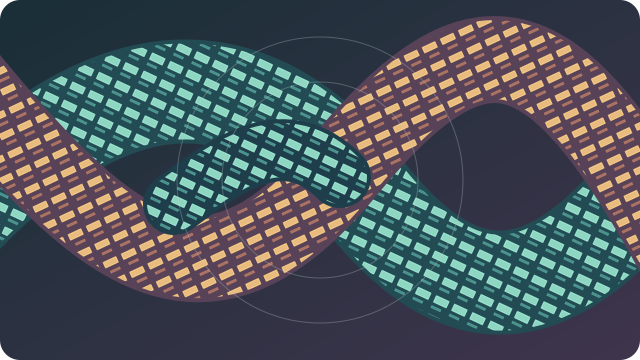](../graphics/v059/bitstream-weave.svg) **VG-108 · Bitstream weave / 像素织带插画** |
| [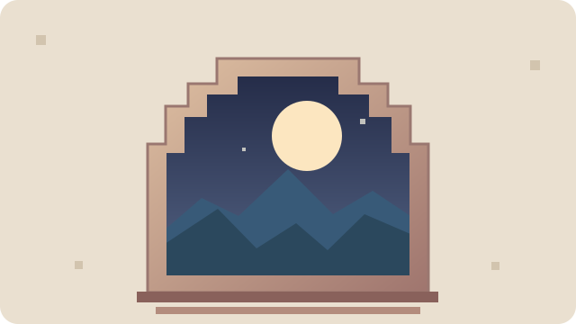](../graphics/v059/glyph-window.svg) **VG-109 · Glyph window / 方格拱窗插画** | [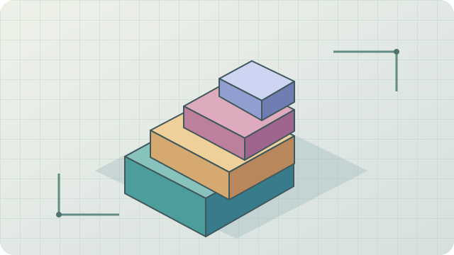](../graphics/v059/stepped-prism.svg) **VG-110 · Stepped prism / 阶梯棱镜插画** |

### Print and procedural patterns / 印刷与程序纹样

| | |
| --- | --- |
| [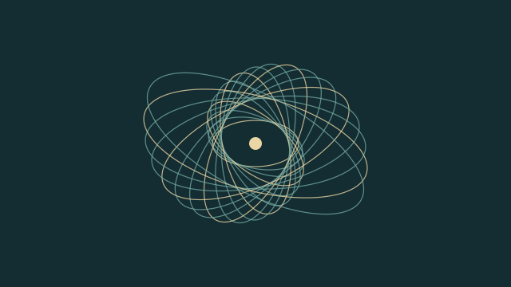](../graphics/v061/orbit-filigree.svg) **VG-111 · Orbit filigree / 轨道丝纹** | [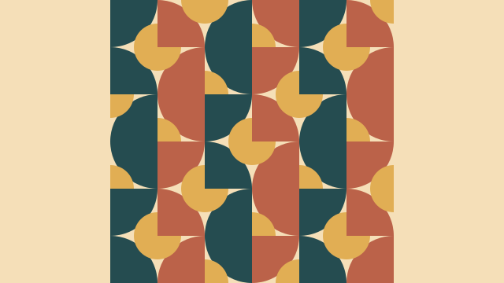](../graphics/v061/quilt-compass.svg) **VG-112 · Quilt compass / 拼砖罗盘** |
| [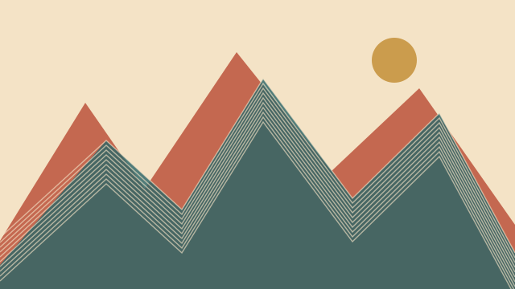](../graphics/v061/overprint-ridge.svg) **VG-113 · Overprint ridge / 套色山脊** |  **VG-114 · Stipple eclipse / 点纹蚀圆** |

[Browse all graphics source](../graphics/) · [Asset index](../registry/assets.json)

## React component spotlight / React 组件精选

The following are actual exported components, selected from the canonical registry. The React package explicitly supports only four theme scopes: `refined-light-saas`, `precision-dark`, `editorial-warm`, `playful-pop`. The fourteen-style atlas is **not** a fourteen-theme React compatibility promise.

| ID | Export | Reference behavior | Source |
| --- | --- | --- | --- |
| `UI-033` | **DataTable** | Generic, controlled sortable data table with selectable rows and semantic table headers | [TSX](../packages/ui/src/advanced.tsx) |
| `UI-038` | **CommandMenu** | Modal grouped searchable command palette with keyboard activation | [TSX](../packages/ui/src/utilities.tsx) |
| `UI-052` | **FilterableDataTable** | Composable controlled local keyword/category filtering and optional comparator sorting around semantic DataTable | [TSX](../packages/ui/src/data-ops.tsx) |
| `UI-053` | **KanbanBoard** | Controlled multi-column task board with native drag and accessible per-card move selector | [TSX](../packages/ui/src/data-ops.tsx) |
| `UI-055` | **InteractiveBarChart** | Controlled accessible interactive bar chart with arrow/Home/End focus and selected data bar | [TSX](../packages/ui/src/data-ops.tsx) |
| `UI-056` | **EditableDataTable** | Controlled semantic table with cell editing, validation and explicit save/cancel | [TSX](../packages/ui/src/editors.tsx) |
| `UI-058` | **FlowEditor** | Controlled node canvas with pointer/keyboard positioning and directional edge creation | [TSX](../packages/ui/src/editors.tsx) |
| `UI-060` | **BeforeAfterCompare** | Controlled visual before/after comparison with pointer drag and native keyboard range | [TSX](../packages/ui/src/cross-context.tsx) |

[All 48 React exports](../registry/components.json) · [Component gallery](../playground/component-gallery/README.md) · [Implementation guide](../packages/ui/README.md)

## Interactive materials / 原生交互素材

| Lab | What to inspect | Source |
| --- | --- | --- |
| [Spatial composition](../playground/spatial-composition-v064/index.html) | Seeded composition, curved media selection, inset-aware fit, node/source linking | [FX-142–147](../styles/primitives/v064/README.md) |
| [Creative micro-controls](../playground/editing-controls-v062/index.html) | HSL plane, gradient stops, alpha proof, bezier and mask controls | [FX-136–141](../styles/primitives/v062/README.md) |
| [Print patterns](../playground/print-patterns-v061/index.html) | Adjustable line patterns and native illustrative atoms | [FX-130–135](../styles/primitives/v061/README.md) |
| [Image/text composition](../playground/composition-v053/index.html) | Caption-first editorial composition and independent layout atoms | [FX source](../styles/primitives/v053/README.md) |
| [Procedural depth](../playground/procedural-depth-v052/index.html) | Layered CSS surfaces and depth studies | [FX source](../styles/primitives/v052/README.md) |

GitHub file links open source, not a hosted interactive preview. To inspect native demos from a clean checkout, run `npm run dev:catalog` at repository root and open `http://localhost:8009/playground/spatial-composition-v064/`. For React, install dependencies and run `npm run dev:components` and open `http://127.0.0.1:5174/`.

For exact deep-linked preview URLs and actual screenshot capture, see [Visual evidence](visual-showcase.md). Check source, lifecycle, dependencies, license and applicability before adapting. No production certification is claimed.
